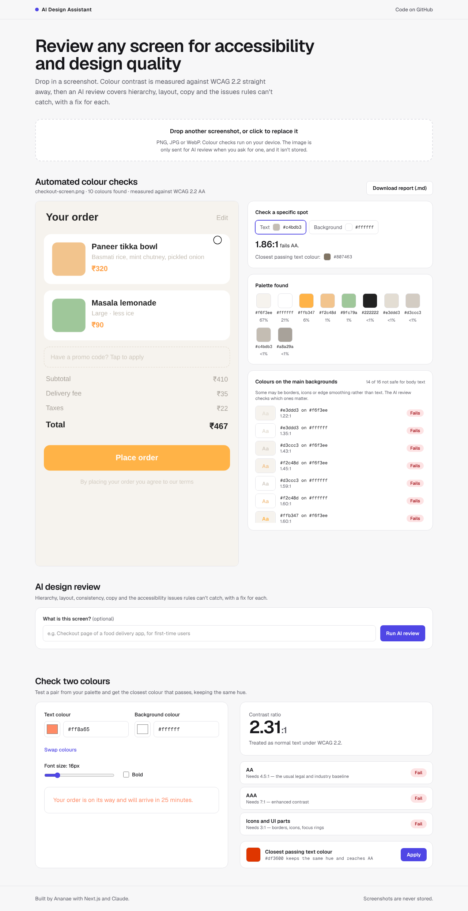

# AI Design Assistant

Review any UI screenshot for accessibility and design quality. Colour contrast is measured against WCAG 2.2 in the browser, then an AI review (Claude) covers hierarchy, layout, consistency, copy and the issues rules can't catch, with a concrete fix for each.



## Features

- **Screenshot colour audit.** Finds the palette, rates every colour against the main backgrounds (pass, large text only, fail), all on the user's device.
- **Pick any spot.** Click a letter and its background, or use the arrow keys and Enter, to measure an exact pair. The picker finds a letter's solid ink colour, not its blurred edge.
- **AI design review.** Severity-ranked issues with category, WCAG reference, location, problem and fix. Measured contrast is passed to the model so it doesn't guess.
- **Shareable report.** Download everything as Markdown for a ticket, PR or design review.
- **Two-colour checker.** Suggests the closest passing colour that keeps the original hue.

## Architecture

```
Browser                                   Server (Next.js route)               Anthropic API
───────                                   ──────────────────────               ─────────────
Upload → canvas → palette + pair ratings
Click / keyboard sampling
"Run AI review" ─ JPEG ≤1568px + context ─▶ /api/critique
                  + failing pairs          validate (Zod) → cache → rate limit
                                           → messages.parse (structured output) ─▶ Claude Haiku 5.5
Issues, filters, report ◀──────────────── typed JSON ◀──────────────────────────
```

## Cost

The rule-based checks are free because they run in the browser. Only the AI review costs money: Claude Haiku 5.5 at $0.10 / $0.50 per million input / output tokens (Anthropic list price, October 2026), so one review of roughly 2,000 input and 1,000 output tokens is about $0.001. Repeat reviews of the same image come from an in-memory cache, and each visitor gets 5 reviews an hour with a 200-a-day cap overall. Hosting runs on Vercel's free tier.

## Getting started

```bash
npm install
cp .env.example .env.local   # add your ANTHROPIC_API_KEY to enable AI review
npm run dev                  # http://localhost:3000
```

| Command             | What it does                                                    |
| ------------------- | --------------------------------------------------------------- |
| `npm test`          | Unit tests (Vitest): contrast maths, palette, API handler, report |
| `npm run e2e`       | Browser tests (Playwright) with axe accessibility scans; needs `npm run build` first |
| `npm run lint`      | ESLint                                                          |
| `npm run typecheck` | Next.js route types + TypeScript                                |
| `npm run build`     | Production build                                                |

CI runs all of these on every push and pull request.

## Deploying

Import the repo at [vercel.com/new](https://vercel.com/new), then add `ANTHROPIC_API_KEY` under Settings → Environment Variables. Set a monthly spend limit in the Anthropic Console.

## Project layout

```
src/
  app/page.tsx              Page layout
  app/api/critique/route.ts AI review endpoint (thin: wires dependencies)
  components/               UI: workspace, sampler, findings, AI review, colour checker
  lib/contrast/             WCAG luminance, ratios, large-text rules, hue-preserving fixes
  lib/palette/              Palette extraction, pair rating, ink-colour sampling
  lib/critique/             Request/response schemas, prompt, Claude call, handler, rate limit, cache
  lib/report/               Markdown report builder
e2e/                        Playwright tests and fixtures
```

## Known limits

- Rate limits and the cache live in server memory, so on serverless hosting they're per instance. A shared store such as Redis is the next step for real traffic.
- The palette can miss very thin text, which takes up few pixels; spot sampling and the AI review cover it.
- AI findings can be wrong. The UI and the report say so.

## Tech stack

Next.js 16, React 19, TypeScript, Tailwind CSS 4, Anthropic TypeScript SDK, Zod, Vitest, Playwright, axe-core, GitHub Actions, Vercel.
